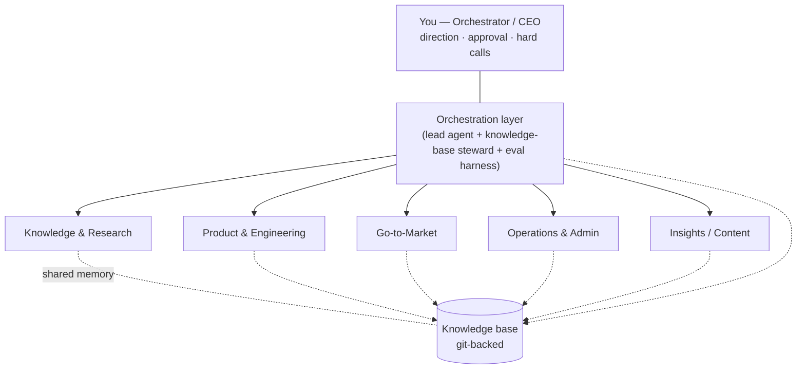
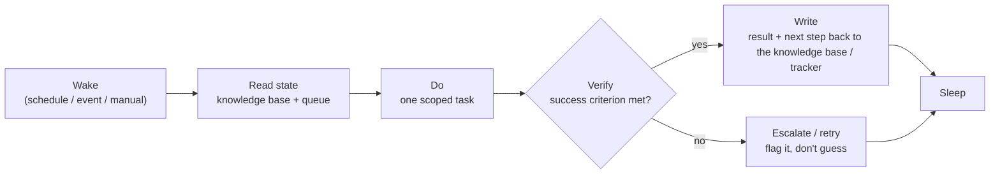
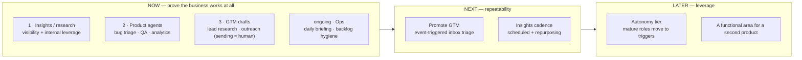

# Architecture

This document describes how a one-person company can be organized as a team of AI agents plus one human. It is the "org chart and operating system" layer. If you want the rollout mechanics — who builds what, in which order — see [runbook.md](runbook.md). For the role catalog and how roles mature, see [roles.md](roles.md).

This is the generalized write-up of the system Late runs on: one person, AI agents, and the gates below.

## The core rule

Everything else in this document is a consequence of one sentence. When two ideas about how to structure agent work conflict, this sentence wins:

> **Agents research, draft, and prepare. Deterministic systems calculate and check. The human decides everything that touches the outside world.**

"Deterministic systems" means normal code — validation, math, business rules — not a model's judgment. Keep the boundary between "an LLM produced this" and "a program checked this" visible everywhere. That boundary is what makes the rest of this architecture trustworthy enough to actually rely on.

## Five principles

These decide every architecture question. Earlier principles outrank later ones.

1. **The human is the orchestrator, not the operator.** You set direction, give approvals, and make the calls that are genuinely hard. Agents carry the operational load. The system is working when your time goes into decisions, not execution.
2. **The knowledge base is the only shared memory.** No agent privately "remembers" anything. State, handoffs, and results live as durable artifacts — notes in a shared wiki, tickets in an issue tracker. Agents are replaceable; the knowledge base is the asset that compounds.
3. **Handoffs happen through artifacts, never through conversation.** An agent passes work along by writing a durable artifact (a note or ticket with a defined shape) that the next agent — or the next you — reads. There is no unstructured, ephemeral agent-to-agent chat that disappears when the session ends.
4. **A human is in the loop for anything with outside impact.** Sending a message, deploying to production, moving money, anything legal: an agent prepares, a human approves. This is the hard trust boundary. It is not negotiable, and it is not a temporary scaffolding step you remove once you trust the agents more — it is permanent by design.
5. **Honesty is an architectural constraint, not a marketing choice.** You only operate — and only claim, externally — what is actually running reliably. A role gets "promoted" to more autonomy only after it passes a quality check. Hype is fragile. The honest version of your setup is the durable one, because it is the only version that survives someone actually asking you how it works.

## Part A — Org structure

Think of your one-person company as an actual company: a human core plus agents as operating team members, organized into functional areas. Each area has a mandate, defined decision rights, and a clear escalation path back to you.

### The org picture

### The areas

The specific roles inside each area live in [roles.md](roles.md). This table is the org mandate, not the role list.

| Area | Mandate | Can do autonomously | Needs approval |
|---|---|---|---|
| **Orchestration layer** | Distribute work, maintain the knowledge base, measure quality. The "chief of staff" layer between you and the functional areas. | Dispatch tasks, file and deduplicate knowledge, run evals | Any outside impact, any strategy change |
| **Knowledge & Research** | External view plus internal memory: watch the market and competitors, supply sources, filter durable knowledge into the wiki | Research, write digests, file into the knowledge base | — (lowest risk, purely internal) |
| **Product & Engineering** | Move your product forward: features, bug fixes, QA, triage, analytics | Draft code, propose changes, write tests, triage bugs into tickets | **Production deploys**, schema migrations |
| **Go-to-Market** | Generate demand: lead research, outreach drafts, inbox triage, CRM upkeep | Research, enrich data, draft messages, update CRM records | **Any outbound send** (email/outreach), any offer |
| **Operations & Admin** | Keep the business running: daily briefing, backlog hygiene, reporting, bookkeeping prep | Summarize, propose priorities, categorize | **Money movement** (never autonomous), final prioritization |
| **Insights / Content** | "Building in public": turn real work into shareable material, repurpose it, keep a cadence | Draft, produce format variants, stage content | **Publishing** (human approves) |

### The one decision-rights pattern

Every area follows the same logic, which is just the core rule applied locally:

> Agents research, draft, and prepare. Deterministic systems calculate and check. The human decides everything that touches the outside world.

This isn't bureaucracy. It's the exact point where trust gets built — and therefore the precondition for being allowed to claim these roles exist at all (see principle 5).

## Part B — System and orchestration

The org structure says *who*. This section says *how*: the substrate, the loop, the handoff, the escalation points, the quality gate.

### 1. The substrate — a shared knowledge base

All areas share exactly one memory: a git-backed Markdown knowledge base. It is simultaneously the inbox, the handoff medium, and the archive. A generalized starting skeleton for this is in [brain-template/](../brain-template/).

- **Scoped folders.** Each area writes into its own folder (research findings, outreach records, content drafts, and so on). This keeps parallel agents from colliding and makes ownership readable from the file path alone.
- **Filing follows a written routing rule, not judgment call.** Where a piece of information belongs is a documented decision, not something each agent reinvents. One steward role — part of the orchestration layer — deduplicates, keeps an index current, and supersedes stale notes instead of deleting them.
- **Git discipline is the only safety rule that matters.** Pull before you start, push after you finish, small focused commits. If you run agents in more than one environment (a desktop agent you drive interactively, an always-on server agent), decide which one owns git writes and keep that boundary — see [runbook.md](runbook.md) §0 for how this plays out with two agent environments.

### 2. Three levels of maturity

Every role runs in one of three modes. The maturity path is always the same direction — low risk to high leverage:

1. **On-demand / copilot.** You start it, you stay in the loop. Every role begins here.
2. **Scheduled / recurring.** Runs on a timer without you (a morning briefing, a weekly report). Reliable copilots graduate here.
3. **Event-triggered / autonomous.** Reacts to an event (a new error report triggers triage, an inbound reply triggers a draft response). Highest leverage, highest required care.

> Rule: prove a role on-demand first. Only promote to scheduled or triggered once it's reliable. Never automate an immature role.

### 3. The heartbeat loop — what turns "a run" into "a team member"

A real team member isn't a single eight-hour monologue. It's a stateful pulse made of many short cycles. Every agent, in every mode, follows the same loop:

The key idea: **state lives in the knowledge base between cycles, not inside the agent.** That makes runs resumable, auditable, and handoff-able — and it means a crashed or replaced agent loses nothing.

### 4. Handoff protocol

Areas cooperate by passing artifacts forward — never by direct, ephemeral back-and-forth. Two handoff media, depending on the kind of work:

- **An issue in your tracker** for product/engineering work. Example chain: bug triage reads an error report, files a prioritized ticket, a coding agent picks it up, a review step checks the change, a human merges it.
- **A knowledge-base note** for research, GTM, and content work. Example chain: a market-monitor role writes a digest, a content role drafts formats from it, a human approves publication.

Every handoff artifact carries: what was done, what's still open, what the next step is, and who's responsible for it. See [templates/handoff.md](../templates/handoff.md) for the exact block. That block is what lets the chain be read without anyone needing to be live and available to explain it.

### 5. Escalation and human-in-the-loop

The architecture stops automatically at defined boundaries and puts the decision in front of you:

- **Outside impact.** Every send (email/outreach), every publish action.
- **Production.** Deploys only go out through your own deploy process, never autonomously; schema rollbacks are never automatic.
- **Money.** Bookkeeping-adjacent agents prepare and categorize — **never** move money or execute payments.
- **Legal / data protection.** No customer personal data (names, addresses, phone numbers) in prompts; legal steps are always human-initiated.
- **Uncertainty.** A success criterion not met, or low confidence — flag and escalate, don't guess.

### 6. The quality / eval loop

Verification is a required gate, not a nice-to-have — over long-running work, small errors otherwise compound silently.

- **Per task:** one success criterion, checked before calling anything "done" (tests pass, a claim is sourced, a schema is satisfied).
- **Per role, before promotion:** a lightweight eval measures whether the role is reliable enough to move from on-demand to scheduled or triggered. See [roles.md](roles.md) for the eval gate itself.
- **Failure isolation.** One agent's failure must not cascade. Supersede instead of deleting; a failed cycle leaves a clean state for the next one.

## Part C — Target architecture and phasing

The full target picture has all functional areas active, with most roles promoted to scheduled or triggered. But you build **one role at a time**, each gated on real proof that it works — not all six areas at once. Big ambition, narrow surface area, including in how you build your own org.

### Build order

### Where each area is heading

Every area starts on-demand. This is where it's aimed at full maturity:

| Area | Target mode at maturity | Stays human-gated |
|---|---|---|
| Knowledge & Research | scheduled (recurring market digest) | — |
| Product & Engineering | event-triggered (triage, review on new change) | Deploy, migrations |
| Go-to-Market | event-triggered (inbox), scheduled (CRM) | Every send |
| Operations & Admin | scheduled (briefing, reporting) | Money movement |
| Insights / Content | scheduled (cadence keeper) | Publishing |
| Orchestration layer | scheduled (eval runs), event (dispatch) | Strategy, outside impact |

### The honesty column

For principle 5 to hold, the knowledge base has to track what is *actually* running, not the aspirational version. A representative real snapshot from the system this template is extracted from:

> **13 roles specified. 4 run for real, on-demand, with a human in the loop. 0 fully autonomous. Nothing on a schedule yet.**

That is not a failure state — it's the honest middle of the maturity path in Part B, and it's exactly the state you should expect to be in for a while. Keep this column dated and current. It is the only source you should trust for any external claim about how automated your operation really is. If you can't currently write a true sentence like the one above for your own setup, that's a signal to slow down on claims, not to stop building.

## See also

- [roles.md](roles.md) — the role catalog, how roles mature, and the guardrails that apply to all of them
- [runbook.md](runbook.md) — how to actually build this, step by step, with two agent environments
- [improvement-loop.md](improvement-loop.md) — the missing layer: how the system gets better over time, not just runs
